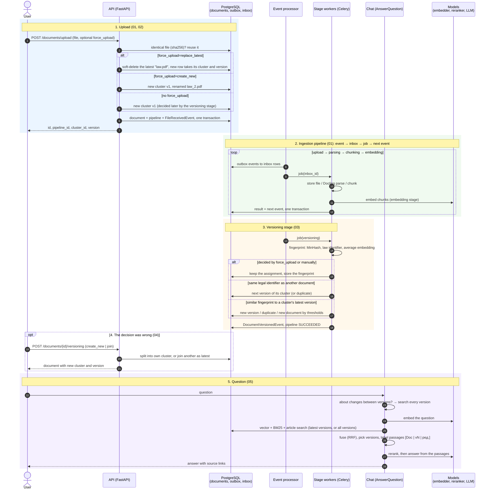

# The whole process

One upload from the file to an answer, at a high level. Each box links to its detailed
diagram: [upload and pipeline](01_upload_and_pipeline.md), [force_upload](02_force_upload.md),
[versioning stage](03_versioning_stage.md), [versioning endpoint](04_versioning_endpoint.md),
[query and retrieval](05_query_and_retrieval.md).

