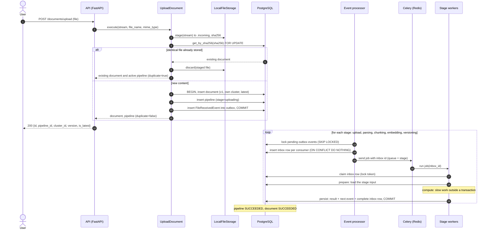

# Upload and the ingestion pipeline

A plain upload (no `force_upload`). Every stage commits its result, the next event and the
inbox acknowledgement in one transaction; Redis only carries inbox ids.

What each stage does and emits:

| Stage | Consumes | Work | Emits |
|---|---|---|---|
| upload | `FileReceivedEvent` | move the file to `media/documents/<id>/`, verify size and sha256 | `FileUploadedEvent` |
| parsing | `FileUploadedEvent` | Docling: nodes, structure JSON, OCR | `DocumentParsedEvent` |
| chunking | `DocumentParsedEvent` | hybrid chunker / text splitter | `DocumentChunkedEvent` |
| embedding | `DocumentChunkedEvent` | chunk vectors in batches | `DocumentEmbeddedEvent` |
| versioning | `DocumentEmbeddedEvent` | fingerprint, assign cluster and version ([03](03_versioning_stage.md)) | `DocumentVersionedEvent` |
