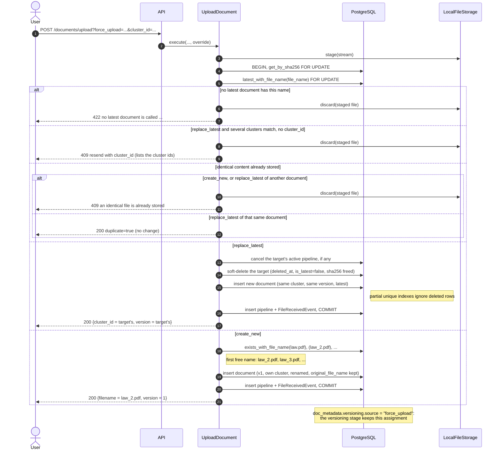

# Upload with `force_upload`

`force_upload` lets a person decide the version at upload time. It only applies when a latest
document with the same file name exists. All errors happen before anything is stored, and the
staged file is discarded.

