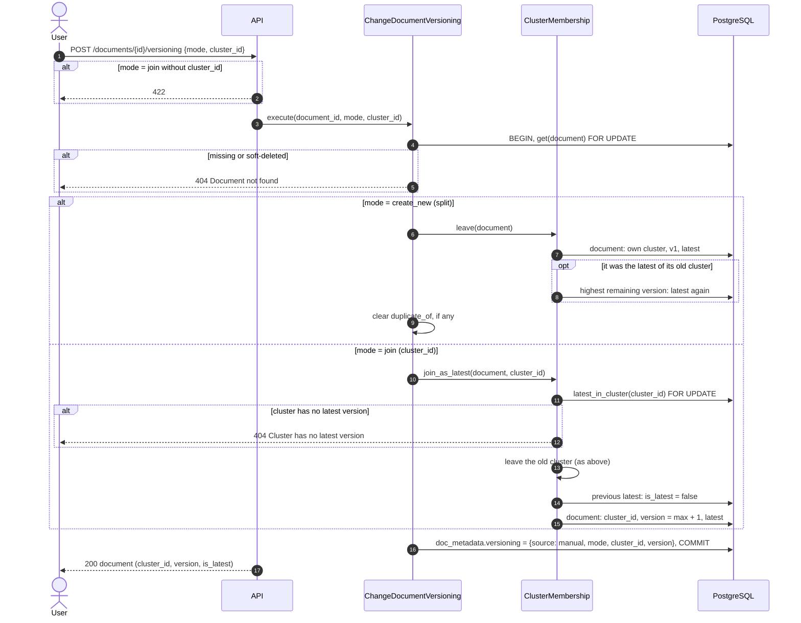

# Fixing a decision: `POST /documents/{id}/versioning`

For a wrong automatic decision found after ingestion, whatever the file names. It is recorded
as `source: manual`, so a rerun of the versioning stage keeps it.

Which tool for which situation:

| Situation | Use |
|---|---|
| A corrected copy of the same file | upload with `force_upload=replace_latest` |
| Same file name, different document | upload with `force_upload=create_new` |
| A new redaction of a law | plain upload (automatic) |
| Two different documents were merged | `versioning` `create_new` |
| A version was missed | `versioning` `join` |
| A document was wrongly marked a duplicate | `versioning` `create_new` |
