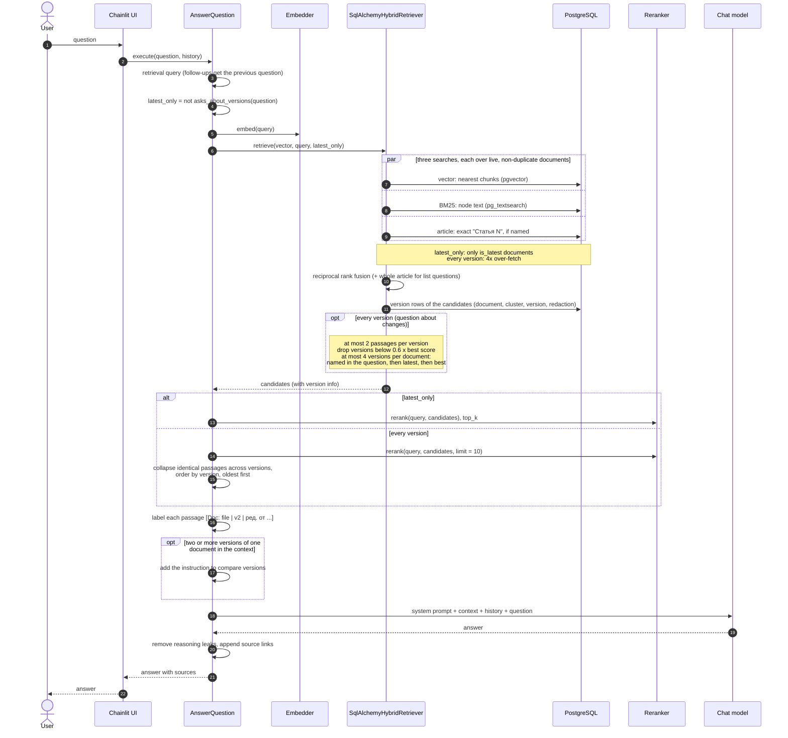

# A question: retrieval and answer

The chat UI calls `AnswerQuestion`; `POST /documents/search` uses the same retriever with an
explicit `latest_only`. Soft-deleted documents and duplicates are never searched.

